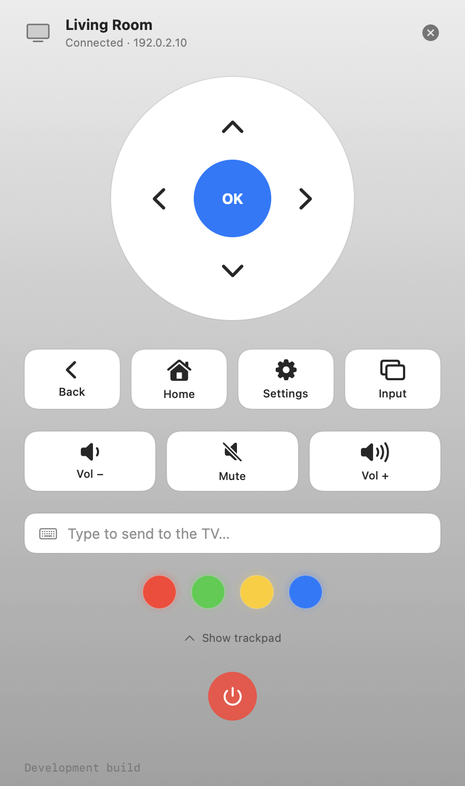

# Whale TV Remote for macOS

Use your Mac as a remote for a Whale TV or projector running compatible Zeasn firmware. The arrow pad controls the TV menus. You can also switch inputs, adjust the volume, move the pointer, or type into a focused search field using your Mac keyboard.



## Install

Requires macOS 13 or later and the Xcode Command Line Tools. If you haven't installed the tools, run `xcode-select --install` and wait for the installer to finish.

```sh
git clone https://github.com/OscarArmas/whale-tv-remote.git
cd whale-tv-remote
./build.sh
open dist/
```

Drag **Whale Remote.app** into Applications. The build also produces an ad-hoc signed DMG for Macs with the same processor architecture as the build machine.

## Connect to your TV

1. Turn on the TV and connect it and your Mac to the same local network.
2. Open Whale Remote, allow local network access if macOS asks, and click **Search TVs**.
3. Select the TV by name or IP address. The remote appears after the TV answers the first heartbeat.

To enter text, focus a field on the TV, type in the remote window, and press Return. The app sends the text followed by Enter. **Show trackpad** opens a pad you can drag to move the pointer or tap to click.

## Compatibility

| Device or firmware | Support |
| --- | --- |
| WhaleOS renderer advertising `Zeasn/1.0.5.13` | Firmware identified in the project's original device tests. Navigation and volume use different services. |
| Other Whale TV or projector firmware | Model coverage is unverified. Navigation needs the Zeasn remote-control extension. Volume and mute need UPnP RenderingControl. |
| Generic DLNA renderers, Chromecast and Roku | Unsupported. Advertising a media renderer alone does not establish compatibility. |

## Troubleshooting

- **The list is empty.** Check local network access for Whale Remote in System Settings if your macOS version lists it. Guest Wi-Fi can isolate devices even when they share a network name. If a VPN is active, check whether it allows local traffic, then search again.
- **The TV stopped responding after a restart.** Run **Search TVs** again. Observed firmware changes its control port on reboot and also advertises a second endpoint on port 1393 that accepts requests but ignores key presses. Whale Remote skips that endpoint.
- **Navigation works but volume fails.** The device must advertise a RenderingControl endpoint and return its current volume or mute state. The remote displays an error if that exchange fails.

## Protocol and privacy

Discovery uses SSDP multicast. The app reads the UPnP device descriptor and sends Zeasn commands inside the `Target` of an AVTransport `Seek` request. Volume and mute use the standard RenderingControl service. While connected, the app sends a heartbeat every ten seconds.

The app requires no account and includes no analytics. Commands and typed text travel over unencrypted HTTP, so use it on a trusted network. The footer reports the character count of submitted text.

## Development

Open `WhaleRemote.xcodeproj` in Xcode or use `./build.sh` with the Command Line Tools. Bundle versions live in [Info.plist](WhaleRemote/Info.plist). Run `Tests/run.sh` to exercise discovery, connection failures, command ordering and text handling with a simulated TV.

[SsdpClient.swift](WhaleRemote/SsdpClient.swift) resolves device descriptors and service addresses. [DlnaRemote.swift](WhaleRemote/DlnaRemote.swift) builds SOAP requests. [RemoteViewModel.swift](WhaleRemote/RemoteViewModel.swift) owns the connection and the command queue.

Independent project, unaffiliated with Whale TV or ZEASN. Distributed under the [MIT license](LICENSE).
